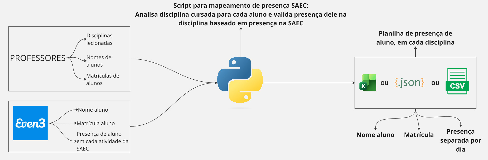
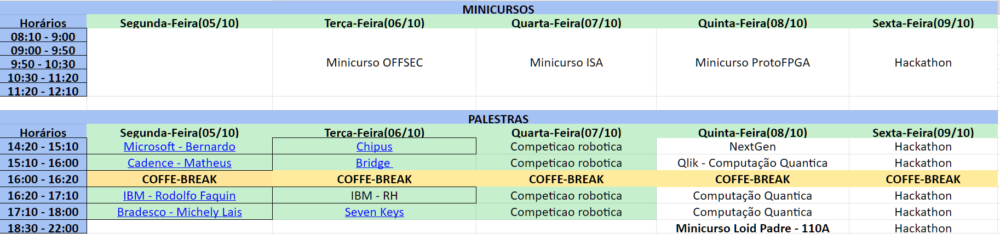

<h1 align="center">Validação automática de presença — SAEC UFSC</h1>

<p align="center">
  
</p>


<p align="center">
  
</p>

## Sobre

Durante a Semana Acadêmica de Engenharia de Computação, a presença nas aulas só vale para quem foi às atividades da semana. O check-in foi feito pelo [Even3](https://www.even3.com.br), e este script cruza esses check-ins com as listas de alunos de cada disciplina. O resultado é uma planilha de presença por disciplina, pronta para entregar aos professores.

**Funcionamento:**

1. Cada nome nas listas de presença do Even3 é ligado à matrícula informada na inscrição. A matrícula é usada como chave porque nomes costumam vir escritos de formas diferentes.
2. Os horários das aulas (`metadata.json`, formato `dia.HHMM-períodos / sala`) são comparados com os horários de cada atividade.
3. O aluno fica **presente** no dia se esteve em qualquer atividade que coincide com o horário da aula. Nos dias em que os eventos são limitados, a presença aparece como **presença opcional**.

Inscrições sem matrícula são descartadas com um aviso. Matrículas digitadas errado são corrigidas quando o nome ou o e-mail bate com a lista da turma. Todos os casos vão para `relatorio.txt`.

## Como usar

Organize os arquivos assim:

```
ListaParticipante_*.xlsx        # exportação de inscritos do Even3
presenca_em_cada_evento/*.pdf   # lista de presença de cada atividade (Even3)
disciplinas/
├── metadata.json               # disciplinas, professores e horários
└── <ID>/<lista da turma>.csv   # exportação de participantes do Moodle
```

Instale as dependências (Python 3.10+) e rode:

```bash
pip install -r requirements.txt
python gerar_presenca.py
```

Se preferir o [uv](https://docs.astral.sh/uv/), `uv run gerar_presenca.py` instala as dependências sozinho.

Cada pasta `disciplinas/<ID>/` recebe `presença.xlsx`, `presença.csv` e `presença.json`, com nome, matrícula e presença em cada dia de aula.

## Cronograma da SAEC

<p align="center">
  
</p>

## LGPD

Em conformidade com a Lei Geral de Proteção de Dados Pessoais ([Lei nº 13.709/2018](https://www.planalto.gov.br/ccivil_03/_ato2015-2018/2018/lei/l13709.htm)), os dados pessoais utilizados por este projeto (nome, e-mail e número de matrícula dos alunos) são tratados exclusivamente para a finalidade de validar a presença nas disciplinas durante a Semana Acadêmica. Todo o processamento ocorre localmente, na máquina de quem executa o script, sem qualquer comunicação de rede, de modo que nenhum dado é transmitido a terceiros, servidores ou serviços externos. Os arquivos de entrada e os resultados gerados não fazem parte deste repositório, que contém apenas o código-fonte. As planilhas de presença são entregues somente aos professores responsáveis por cada disciplina e, concluída a entrega, todos os dados de entrada e os arquivos gerados são apagados.
